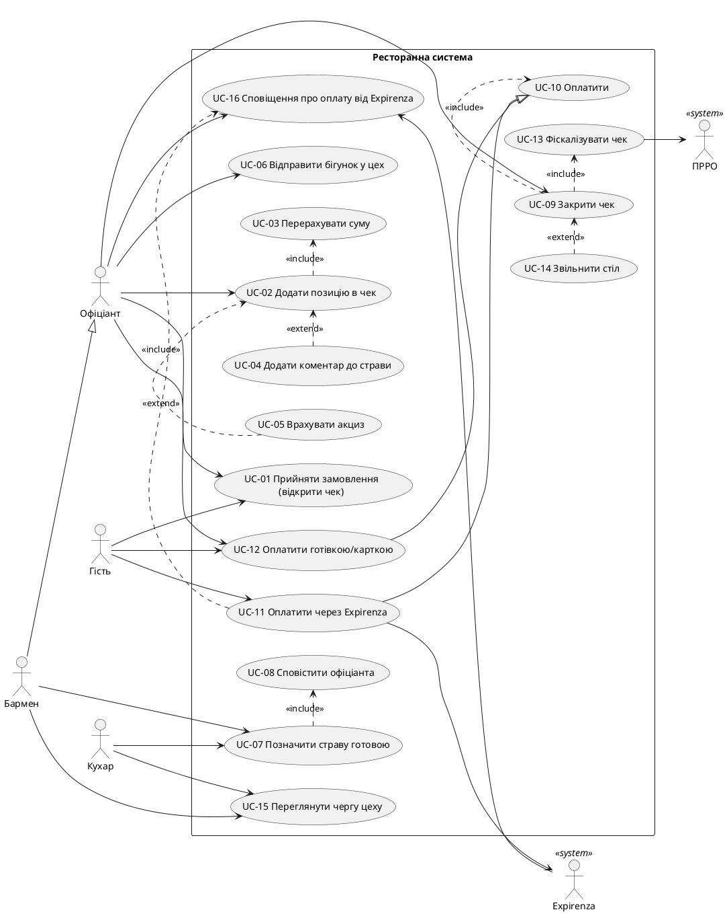

# Специфікація вимог: ресторанна система

## 1. Актори та цілі

| Актор     | Тип              | Головна мета                                                                                    |
| --------- | ---------------- | ----------------------------------------------------------------------------------------------- |
| Офіціант  | людина           | відкрити чек, прийняти замовлення гостя й закрити чек                                           |
| Гість     | людина           | розрахуватися можливо за QR-кодом , готівка, термінал(карта), за потреби зі знижкою та чайовими |
| Кухар     | людина           | приготувати страви cold shop / hot shop                                                         |
| Бармен    | людина           | Працюе за стойкою в залі разом з офіціантами і може працювати з гостями                         |
| Expirenza | зовнішня система | прийняти оплату за QR і передати чайові                                                         |
| ПРРО      | зовнішня система | фіскалізувати чек і повернути фіскальний номер                                                  |
## 2. User stories

US-01: Посадка гостя Як офіціант, я хочу посадити гостей за вільний стіл, щоб стіл отримав статус «зайнятий».

Критерії прийняття:

- Можна обрати лише вільний стіл.

US-02: Окремі чеки для гостей робить офіціант, мені треба відкрити окремий чек для кожного гостя, який платить окремо (або один спільний, якщо платять разом).

Критерії прийняття:

- Спосіб оплати (разом чи окремо) відомий до початку замовлення.
- За одним столом може бути кілька відкритих чеків.
- Кожна позиція належить свому чеку.

US-03: Перегляд меню гість, хоче бачити актуальне меню з цінами, щоб обрати страви.

Критерії прийняття:

- Меню показує назву, ціну й категорію страви.
- Недоступні страви позначені.

US-04: Прийом замовлення офіціантом, має додавати страви до чека, щоб замовлення було зафіксоване.

Критерії прийняття:

- Сума чека перераховується після кожної позиції.
- Недоступну страву додати не можна.

US-05: Коментар до страви додає офіціант (наприклад, «без цибулі»), щоб кухня врахувала побажання гостя.

Критерії прийняття:

- Коментар можна додати до відправки бігунка.
- Кухня бачить коментар разом із позицією.

US-06: Акциз при введенні алкоголю офіціантом, щоб при додаванні алкогольної позиції акциз враховувався одразу, щоб він потрапив у чек і в ПРРО без окремих дій.

Критерії прийняття:

- Алкогольні позиції мають ознаку акцизу.
- Акциз розраховується в момент додавання позиції до чека.

US-07: Бігунок на кухню і бар Як офіціант, я хочу, щоб після введення замовлення бігунок автоматично пішов у потрібний цех (cold shop, hot shop, bar), щоб кожен цех бачив лише свої позиції.

Критерії прийняття:

- Цех визначається категорією страви.
- Позиція отримує статус «відправлено».

US-08: Приготування страв кухарем або напоїв барменом, Їм треба бачити чергу бігунків свого цеху й позначати позиції «готово», щоб офіціант знав, що страву можна забирати.

Критерії прийняття:

- Позиції відображаються в порядку надходження.
- Час готовності фіксується.

US-09: Сповіщення про готовність офіціанту, має отримувати сповіщення про готову страву з номером столу, щоб віднести її гостю.

Критерії прийняття:

- Сповіщення містить номер столу та назву позиції.
- Після видачі гостю позиція отримує статус «подано».

US-10: Оплата гостем, хочу оплатити чек за QR-кодом через Expirenza або готівкою/карткою через офіціанта, щоб розрахуватися зручним способом.

Критерії прийняття:

- Чек вважається оплаченим лише після підтвердження платежу.
- При невдалій оплаті чек залишається відкритим.

US-11: Фіскальний чек закладу, для того щоб після оплати чек автоматично фіскалізувався через ПРРО, щоб продаж відповідав закону.

Критерії прийняття:

- Фіскальний номер зберігається разом із чеком.
- При помилці фіскалізації можна повторити спробу.

US-12: Закриття столу офіціантом, для того щоб стіл звільнявся, коли гості оплатили свої чеки, щоб за нього можна було посадити нових гостей.

Критерії прийняття:

- Чек закривається в момент оплати.
- Стіл звільняється, коли оплачено всі чеки за цим столом.
- Закритий чек зберігається в історії.

  ## 3. EARS-вимоги

| ID     | Вимога                                                                                                                                                                       | Історія      |
| ------ | ---------------------------------------------------------------------------------------------------------------------------------------------------------------------------- | ------------ |
| REQ-01 | WHEN офіціант приймає замовлення від гостя або групи, що платять разом, the system SHALL створити окремий `CHECK` із `server_id`, `table_id` і `time_create` = поточний час. | US-01        |
| REQ-02 | WHEN офіціант додає позицію меню у відкритий чек, the system SHALL створити `RUNNER` із `check_id`, `menu_id` і `quantity`.                                                  | US-03        |
| REQ-03 | IF позиція меню недоступна, THEN the system SHALL відхилити додавання та показати «Позиція недоступна».                                                                      | US-02, US-03 |
| REQ-04 | WHEN створено `RUNNER`, the system SHALL перерахувати `total_amount` як суму `price × quantity` усіх позицій чека.                                                           | US-03        |
| REQ-05 | WHERE до позиції вказано коментар, the system SHALL зберегти коментар у `RUNNER`.                                                                                            | US-04        |
| REQ-06 | WHERE `MENU.excise` = true, WHEN позицію додано до чека, the system SHALL додати акциз по цій позиції до даних чека.                                                         | US-05        |
| REQ-07 | WHEN офіціант відправляє бігунок, the system SHALL передати його в цех за `MENU.category` (cold shop, hot shop або bar).                                                     | US-06        |
| REQ-08 | WHEN `RUNNER` передано в цех, the system SHALL встановити його статус «відправлено».                                                                                         | US-06        |
| REQ-09 | WHILE у цеху є бігунки зі статусом «відправлено», the system SHALL показувати їх працівникам цього цеху в порядку надходження разом із коментарем.                           | US-04, US-07 |
| REQ-10 | WHEN працівник цеху позначає позицію «готово», the system SHALL зберегти час готовності.                                                                                     | US-07        |
| REQ-11 | WHEN працівник цеху позначає позицію «готово», the system SHALL повідомити офіціанта, який відкрив чек, із номером стола та назвою позиції.                                  | US-08        |
| REQ-12 | IF Expirenza повертає помилку, THEN the system SHALL залишити чек відкритим і показати помилку.                                                                              | US-09        |
| REQ-13 | WHEN Expirenza підтверджує оплату або офіціант підтверджує отримання готівки чи оплату терміналом, the system SHALL позначити чек оплаченим.                                 | US-09        |
| REQ-14 | WHEN чек позначено оплаченим, the system SHALL надіслати його в ПРРО.                                                                                                        | US-10        |
| REQ-15 | WHEN ПРРО повертає фіскальний номер, the system SHALL зберегти його в `fiscal_number` чека.                                                                                  | US-10        |
| REQ-16 | IF ПРРО не підтверджує фіскалізацію, THEN the system SHALL залишити чек відкритим і повідомити офіціанта.                                                                    | US-10        |
| REQ-17 | WHEN збережено `fiscal_number`, the system SHALL встановити `time_closed` = поточний час.                                                                                    | US-11        |
| REQ-18 | WHEN закрито останній відкритий чек столу, the system SHALL позначити стіл «вільний».                                                                                        | US-11        |


## 4. Gherkin-сценарії

У коментарі над кожним сценарієм вказано, які REQ він перевіряє.

``` gherkin
Feature: Замовлення, робота цехів та оплата

  # REQ-01
  Scenario: SC-01 Декілька чеків за одним сталом 
    Given за столом 5 сидить компанія друзів кожний плате за себе сам
    When офіціант приймає окремий заказ від кожного
    Then створено 5 окремих чеки з table_id = 5
    And кожен чек має server_id цього офіціанта і time_create = час початку ввода замовлення  

  # REQ-01
  Scenario: SC-02 Один спільний чек
    Given за столом 5 сидить пара гостей
    When офіціант приймає замовлення 
    Then створено один чек з table_id = 5
    And чек має server_id цього офіціанта і time_create = час початку ввода замовлення

  # REQ-02, REQ-04
  Scenario: SC-03 Додавання страви в чек
    Given відкрито чек №1 за столом 5
    When офіціант додає декілька супів(борщ,уха) по 120 грн
    Then в чеку №1 створено бігунок: страва «борщ»,«уха», quantity = 2
    And total_amount чека №1 дорівнює 240 грн

  # REQ-03
  Scenario: SC-04 Недоступна страва
    Given у меню позиція «Устриці» відсутня 
    When офіціант спробував додати «Устриці» в чек №1
    Then система показує «Позиція недоступна»
    And позиція не додалась у бігунок
    And total_amount чека №1 не змінився

  # REQ-02, REQ-05
  Scenario: SC-05 Страва з коментарем
    Given відкрито чек №1 за столом 5
    When офіціант додає «борщ» з коментарем «без цибулі»
    Then створено бігунок «борщ»
    And коментар «без цибулі» збережено в бігунку

  # REQ-02, REQ-06
  Scenario: SC-06 Алкоголь з акцизом
    Given відкрито чек №1
    When офіціант додає пляшку вина (категорія bar, excise = true)
    Then створено бігунок для вина
    And акциз по цій позиції додано до даних чека №1

  # REQ-07, REQ-08, REQ-09
  Scenario: SC-07 Відправка страви в гарячий цех
    Given ще є інші бігунки гарячого цеху вже є бігунок «солянка»
    And у чеку №1 є бігунок «борщ» з коментарем «без цибулі»
    When офіціант відправляє бігунок «борщ»
    Then бігунок «борщ» відправлен в гарячий цех
    And бігунок «борщ» має статус «відправлено»
    And по черзі в гарячого цеху «борщ коментар:(без цибулі)» буде після «солянки»

  # REQ-07, REQ-09
  Scenario: SC-08 Бігунки відправляются по різним цехам
    Given у чеку №1 є бігунки «борщ» (hot shop) і «вино» (bar)
    When офіціант відправляє бігунки чека №1 стіла 5 
    Then «борщ» з'являється лише в черзі гарячого цеху
    And «вино» з'являється лише в черзі бару

  # REQ-10
  Scenario: SC-09 Страва готова
    Given бігунок «борщ» чека №1 (стіл 5, офіціант Андрій) стоїть у черзі гарячого цеху
    When кухар зробив «борщ»  і позначив его як «готово»
    Then офіціант отримує сповіщення «Стіл 5: борщ»

  # REQ-12, REQ-13, REQ-14, REQ-16, REQ-17
  Scenario: SC-10 Оплата через Expirenza
    Given чек №1 є єдиним відкритим чеком стола 5
    And ПРРО працює і повертає фіскальний номер
    When Expirenza підтверджує оплату 
    Then чек №1 позначено оплаченим і надісланим в ПРРО
    And отриманий фіскальний номер збережено в fiscal_number
    And чек №1 отримує time_closed
    And стіл 5 отримує статус «вільний»

  # REQ-11
  Scenario: SC-11 ошибка Expirenza
    Given гість пробує оплатити чек №1 через Expirenza
    When Expirenza повертає помилку
    Then чек №1 лишається відкритим
    And система показує помилку

  # REQ-12, REQ-13, REQ-14, REQ-16
  Scenario: SC-12 Оплата готівкою
    Given чек №1 відкрито, гість платить готівкою
    And ПРРО працює і повертає фіскальний номер
    When офіціант підтверджує отримання готівки
    Then чек №1 позначено оплаченим і надіслано в ПРРО
    And отриманий фіскальний номер збережено в fiscal_number
    And чек №1 отримує time_closed

  # REQ-15
  Scenario: SC-13 ПРРО не підтвердив фіскалізацію
    Given чек №1 оплачено і надіслано в ПРРО
    When ПРРО не підтверджує фіскалізацію
    Then чек №1 лишається відкритим (time_closed порожній)
    And офіціант отримує повідомлення про помилку фіскалізації
    
    
  # REQ-12, REQ-13, REQ-14, REQ-16
  Scenario: SC-15 Оплата через термінал
    Given чек №1 відкритий, гість платить карткою через термінал
    And ПРРО працює і повертає фіскальний номер
    When офіціант підтверджує оплату терміналом
    Then чек №1 позначено оплаченим і надіслано в ПРРО
    And отриманий фіскальний номер збережено в fiscal_number
    And чек №1 отримує time_closed

  # REQ-16, REQ-17
  Scenario: SC-14 Закрито не останній чек столу
    Given за столом 5 відкрито два чеки: №1 і №2
    When для чека №1 збережено fiscal_number
    Then чек №1 отримує time_closed
    And стіл 5 не отримує статус «вільний», бо чек №2 лишається відкритим
```

## 5. Use Case UML-діаграма


