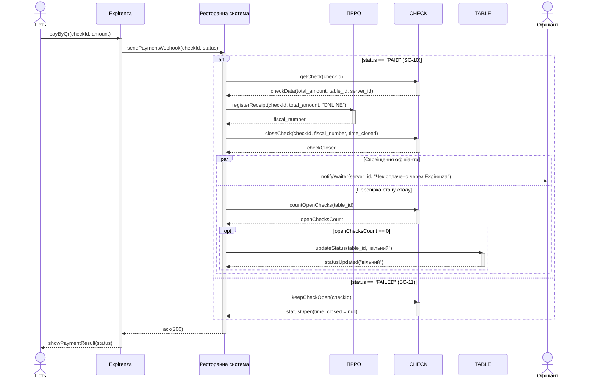
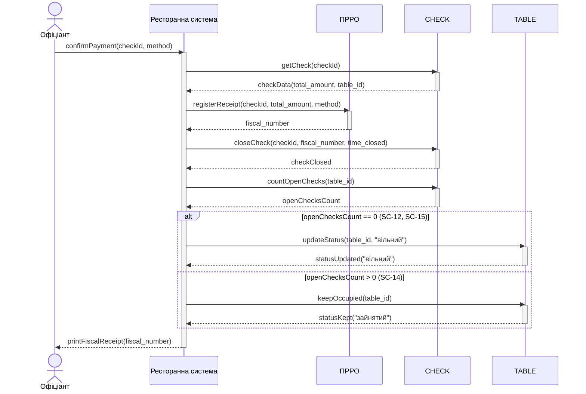

# Специфікація прецеденту «Оплата, фіскалізація та закриття чека» 
## 1. Обраний Use Case та зв'язок із Завданням 2
Для деталізації внутрішньої логіки роботи системи обрано блок прецедентів оплати із Завдання 2:

* **Базовий прецедент:** `UC-10 Оплатити`

* **Узагальнені способи оплати:** `UC-11 Оплатити через Expirenza`, `UC-12 Оплатити готівкою/карткою`

* **Включені (`<<include>>`) та розширювальні (`<<extend>>`) прецеденти:** `UC-13 Фіскалізувати чек`, `UC-09 Закрити чек`, `UC-16 Сповіщення про оплату від Expirenza`, `UC-14 Звільнити стіл`

Інші прецеденти ресторанної системи (прийом замовлення `UC-01`–`UC-05`, робота кухні й бару `UC-06`–`UC-08`, `UC-15`) до цієї специфікації не входять.
### Зведення Gherkin-сценаріїв із Завдання 

П'ять сценаріїв оплати із Завдання 2 (`SC-10`, `SC-11`, `SC-12`, `SC-14`, `SC-15`) зведено у **2 базові сценарії** за каналами оплати:

1. **Сценарій 1: Оплата через Expirenza** — покриває успішну QR-оплату (`SC-10`) та помилку платіжного шлюзу (`SC-11`).

2. **Сценарій 2: Оплата готівкою або карткою через термінал** — покриває оплату готівкою (`SC-12`), оплату терміналом (`SC-15`) та випадок, коли закритий чек не є останнім за столом (`SC-14`).

  

*(Примітка: сценарій `SC-13 ПРРО не підтвердив фіскалізацію` винесено за межі `UC-10`, оскільки він описує виняткову помилку зовнішнього сервісу фіскалізації `UC-13`, а не процес оплати).*
## Діограма

---
## 2. Учасники взаємодії
Усі учасники відповідають акторам із Завдання 2 та сутностям ER-моделі із Завдання 1:

| **'Учасник'**m | Тип у Mermaid | Роль у сценаріях оплати та атрибути з ER-моделі |

| **`Гість`** | `actor` | Ініціює безконтактну оплату чека за QR-кодом у сервісі Expirenza. |

| **`Офіціант`** | `actor` | Підтверджує отримання готівки чи оплату карткою через термінал, отримує сповіщення та фіскальний чек. |

| **`Ресторанна система`** | `participant` | Основний програмний компонент закладу: обробляє оплату, взаємодіє з ПРРО, оновлює чеки й статуси столів. |

| **`Expirenza`** | `participant` | Зовнішній платіжний сервіс для проведення оплати за QR-кодом та надсилання webhook-статусу. |

| **`ПРРО`** | `participant` | Зовнішній сервіс фіскалізації чеків, що повертає фіскальний номер (`fiscal_number`). |

| **`CHECK`** | `participant` | Сутність чека з ER-моделі (`check_id`, `server_id`, `table_id`, `time_create`, `total_amount`, `fiscal_number`, `time_closed`). |

| **`TABLE`** | `participant` | Сутність столу з ER-моделі (`table_id`, статус `"вільний"` або `"зайнятий"`). |

---
## 3. Детальні кроки сценаріїв

### Сценарій 1: Оплата через Expirenza (`SC-10`, `SC-11`)

* **Покриті вимоги із Завдання 2:** `REQ-11`, `REQ-12`, `REQ-14`, `REQ-15`, `REQ-17`, `REQ-18`.

* **Передумови:** існує відкритий чек (`time_closed = null`) для столу `table_id`.

* **Послідовність кроків:**

1. `Гість` виконує оплату чека за QR-кодом у сервісі `Expirenza` (`payByQr(checkId, amount)`).

2. `Expirenza` передає результат транзакції у `Ресторанну систему` (`sendPaymentWebhook(checkId, status)`).

3. **Гілка успішної оплати (`alt [status == "PAID"]`, покриває `SC-10`):**

* `Ресторанна система` зчитує дані чека із сутності `CHECK` (`getCheck(checkId)` → `total_amount`, `table_id`, `server_id`).

* Відправляє чек на фіскалізацію в `ПРРО` (`registerReceipt(checkId, total_amount, "ONLINE")`) та отримує `fiscal_number`.

* Зберігає `fiscal_number` і поточний час закриття `time_closed` у `CHECK` (`closeCheck(checkId, fiscal_number, time_closed)`).

* Паралельно (`par`):

* надсилає `Офіціанту` сповіщення про оплату (`notifyWaiter(server_id, "Чек оплачено через Expirenza")`);

* перевіряє кількість інших відкритих чеків за цим столом у `CHECK` (`countOpenChecks(table_id)`). Якщо відкритих чеків більше немає (`opt [openChecksCount == 0]`), оновлює статус столу в `TABLE` на `"вільний"` (`updateStatus(table_id, "вільний")`).

4. **Гілка помилки оплати (`else [status == "FAILED"]`, покриває `SC-11`):**

* `Ресторанна система` залишає запис у `CHECK` відкритим (`keepCheckOpen(checkId)`, поле `time_closed` залишається порожнім).

5. `Ресторанна система` підтверджує прийом webhook-повідомлення (`ack(200)`), а `Expirenza` відображає `Гостю` результат операції (`showPaymentResult(status)`).

---
### Сценарій 2: Оплата готівкою або карткою через термінал (`SC-12`, `SC-14`, `SC-15`)

* **Покриті вимоги із Завдання 2:** `REQ-13`, `REQ-14`, `REQ-15`, `REQ-17`, `REQ-18`.

* **Передумови:** існує відкритий чек (`time_closed = null`), гість розраховується готівкою або карткою через POS-термінал.

* **Послідовність кроків:**

1. `Офіціант` підтверджує у `Ресторанній системі` отримання готівки (`method = "CASH"`) або оплату карткою (`method = "TERMINAL"`) викликом `confirmPayment(checkId, method)`.

2. `Ресторанна система` отримує суму чека та номер столу із сутності `CHECK` (`getCheck(checkId)` → `total_amount`, `table_id`).

3. Передає дані чека в `ПРРО` (`registerReceipt(checkId, total_amount, method)`) та отримує фіскальний номер `fiscal_number`.

4. Оновлює запис у `CHECK`: зберігає `fiscal_number` та встановлює `time_closed` (`closeCheck(checkId, fiscal_number, time_closed)`).

5. Перевіряє у `CHECK` кількість відкритих чеків за столом `table_id` (`countOpenChecks(table_id)`):

* **Якщо це був останній відкритий чек (`alt [openChecksCount == 0]`, покриває `SC-12`, `SC-15`):** змінює статус столу в `TABLE` на `"вільний"` (`updateStatus(table_id, "вільний")`).

* **Якщо за столом ще є відкриті чеки (`else [openChecksCount > 0]`, покриває `SC-14`):** залишає стіл у `TABLE` зі статусом `"зайнятий"` (`keepOccupied(table_id)`).

1. `Ресторанна система` повертає `Офіціанту` підтвердження та друкує фіскальний чек (`printFiscalReceipt(fiscal_number)`).

## 2. Сценарій 2: Оплата готівкою або карткою через термінал (`SC-12`, `SC-14`, `SC-15`)

